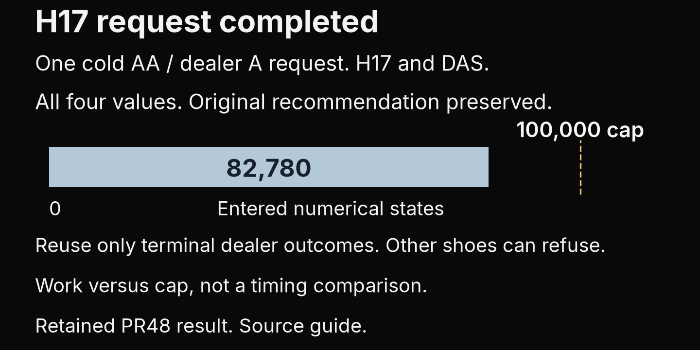
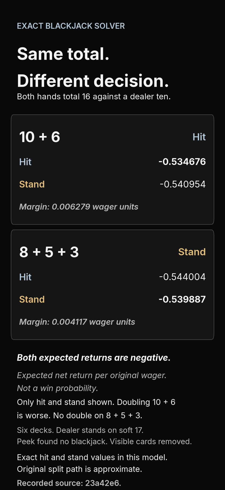
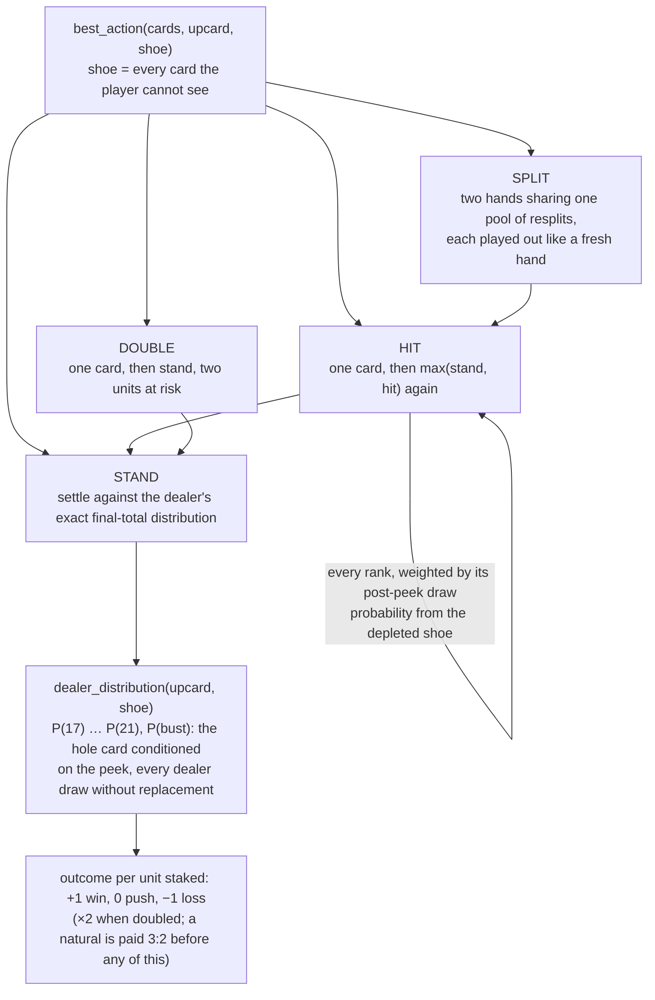

# Exact Blackjack Solver

[](https://github.com/T92T1914/exact-blackjack-solver/actions/workflows/ci.yml)
[](.github/workflows/ci.yml)
[](LICENSE)

The same total can call for different decisions. I wanted to follow
that difference down to the cards left in the shoe, then check the calculations
with an independent simulation. The tool shows each action value and the
margin between the best two choices so a close decision is visible.

A composition dependent blackjack solver that enumerates action values from
the remaining cards using binary floating point. The original/default path
approximates split hands independently with a greedy shared resplit budget.
Separately selected bounded common shoe models carry shared depletion and
completed wagers through their declared joint continuations. Each has an
explicit model identity, supported subset and complete result or refusal.
These calculations enumerate finite models. They are not symbolic real
arithmetic, Monte Carlo estimates or learned predictions.

[Run it](#run-it) | [Supported calculation models](#supported-calculation-models) | [A complete H17 ace calculation](#a-complete-h17-ace-calculation) | [A worked decision](#a-worked-decision) | [How it works](#how-it-works) | [The derived chart](#the-chart-the-solver-derives) | [What this does not prove](#what-this-does-not-prove)

I extracted and generalized this from a larger private project. This repository
contains the solver, dealer model and verification harness, with a standalone
CLI and test suite. It runs locally on Python 3.11+ and needs no account or
network connection to calculate a decision.

The solver uses dynamic programming. It walks the possible continuations
of a hand, weights them by the remaining cards and caches repeated states.
The dealer follows a fixed drawing rule. There are no learned weights or
opponent predictions. The original split approximation remains the default
and still applies to the derived chart and whole game estimates.

[Explore the browser demo](https://t92t1914.github.io/exact-blackjack-solver/) · [Open in Codespaces](https://codespaces.new/T92T1914/exact-blackjack-solver) · [Read in another language](https://github.com/T92T1914/T92T1914/blob/main/TRANSLATION.md)

Use **Link to this example** in the browser demo to share the selected result.
The URL keeps the example's visible label, and Back and Forward restore earlier
selections. These links inspect saved evidence; they do not run a new calculation.

The page starts in Obscur. You can choose Clair or let Auto follow your system.
Your selected appearance stays in this project's browser storage. Switching
keeps the hand, values and share link intact. The original recorded diagram
and source data remain available without JavaScript and keep their original
bytes. The interface uses locally installed Inter when available, with a system
font fallback for other visitors. It does not download fonts.

## Run it

Install the reviewed source without a development checkout:

```sh
python -m pip install "https://github.com/T92T1914/exact-blackjack-solver/archive/56abec59bab328c8856c824eac36f0e00775c18d.zip"
bj-advise T,4 T --unseen 2,3,7,8,9,T --json
```

This pins the accepted source rather than a package version label. It requires
network access, pip's build support and dependency installation. The installed
engine needs no account or network connection to calculate a decision. The
[local calculation guide](docs/local-calculation.md) also describes installation
from a reviewed wheel and the floating `main` source archive.

For development from this repository:

```sh
python -m pip install -e ".[dev]"
python demo.py 8,8 T
python demo.py --table
python -m pytest -q -m "not slow"
```

Use `python -m pip install -e .` if you only want the solver. Both installs
provide the `bj-advise` command. Runtime and table generation time depend on
the machine; the ordinary test command excludes the long statistical runs.

Python 3.11+ and `numpy` (used only by the Monte Carlo harness). CI lints and
runs the suite on Python 3.11, 3.12 and 3.13. Two more examples are `bj-advise T,6 T` and `bj-advise A,7 3`; `--decks`, `--h17` and
`--no-das` change the table (`bj-advise 6,5 A --h17` is a dealer hits soft 17
table). The [contribution guide](CONTRIBUTING.md) includes the longer statistical
checks and the environment commands for PowerShell and other shells.
`ruff check .` runs the same lint check as CI.

In the Python chart interface, `basic_action` treats `can_double` and
`can_split` as additional restrictions on the selected rules. Passing `True`
cannot permit a double after split when DAS is off, exceed `max_hands`, or
resplit aces when that rule is off. Passing `False` removes the action and
keeps the chart's fallback explanation.

The public `bj.simulate.compiled_action` lookup applies the same restrictions.
Pass `hand_count` when checking a hand in a round that has already split.
It counts all hands currently in play and defaults to 1. The simulation round
loop already tracks this count and applies the rules before each action.

`best_action` reports a completed 21 as standing with no alternative action
and a zero decision margin. An unsplit natural receives its posted payout.
A split or drawn 21 uses ordinary dealer settlement and can still reject
an explicit shoe that cannot supply the dealer's required cards.

The command line can also inspect an explicit remaining shoe or a hand that
has already split:

```sh
bj-advise T,4 T --unseen 2,3,7,8,9,T
bj-advise A,T T --unseen 9 --split-hand
bj-advise 8,8 T --unseen 7,8,9,T --split-hand --hand-count 4
```

`--unseen` lists every card still unseen, including the dealer's hidden hole
card. Remove visible cards before supplying this list. The command does not
subtract them again. Rank aliases such as K, Q, J and 10 all count as T.
`--split-hand` identifies the first card as the original split rank. The hand
count includes completed hands in the same round and defaults to two for a
split hand. It controls the remaining shared split allowance. `--no-das`
still removes doubling after a split.
When split aces receive only one card, a split hand beginning with A must
contain exactly two cards. A longer hand is rejected in text and JSON advice.

Reports for an explicit shoe print the supplied rank counts. Split reports also print
the round state. These reports omit the
whole game estimate for a fresh shoe because it describes a different starting
state. The ordinary command and its recorded example remain unchanged.
A shortage that prevents required dealer draws is an error, not an invented
settlement or reshuffle. Explicit shoes make constructed cases inspectable. In
this ordinary command, they do not remove the original split approximation or
establish a full shoe error bound. Select a named model below for a supported
joint calculation.

For a portable record of one decision, add `--json`:

```sh
bj-advise T,4 T --unseen 2,3,7,8,9,T --json
```

The versioned JSON contains normalized cards, the dealer upcard, complete
remaining rank counts, all rules, split state and hand count. It records whether
the counts were supplied or made from a fresh shoe minus visible cards. Action
values and the decision margin retain their floating point precision in original
wager units. This mode computes one hand, with no whole game estimate. The
ordinary text output stays unchanged, and `--json` cannot accompany `--table`.

The same record is available without parsing console text:

```python
from bj.core import Rules
from bj.ev import best_action
from bj.record import decision_record

record = decision_record("T,4", "T", shoe=(0, 1, 1, 0, 0, 0, 1, 1, 1, 1))
state = record["state"]
action, values, margin = best_action(
    state["cards"], state["dealer_up"], shoe=tuple(state["shoe"]["counts"]),
    rules=Rules(**record["rules"]), is_split_hand=state["is_split_hand"],
    hand_count=state["hand_count"],
)
```

`bj.record.decision_json` serializes this original/default record. Schema version 1 includes the
package version and the model qualifications. The hole stays hidden, values
assume the dealer peek has ruled out a natural, and ten value ranks collapse to
T. Insurance is not priced in a hand decision. Split still uses independent
hands and a greedy shared resplit budget, with no general error bound. The
record refuses unsupported rules for no peek, surrender and restricted doubling.
It also refuses rules that distinguish ten value ranks when deciding whether cards form a pair.
Invalid states and
nonfinite results also fail before a JSON record is emitted. These checks belong
to the record interface and do not change the existing solver arithmetic.

Later records declare their separately selected model. The bounded late
surrender and deferred second card families do not change what an older record
means. [Saved record replay](docs/saved-record-replay.md) validates the recorded
inputs and recomputes through the installed engine without trusting the saved
answer. [Protected replay](docs/protected-replay.md) adds the existing disposable
worker owner. The browser inspector reads and compares files locally without
recomputing or uploading them.

## Supported calculation models

Save a request from the appropriate guide, then use `bj-calculate` in your
installed environment. Successful results use the same record, replay and
[local inspector](https://t92t1914.github.io/exact-blackjack-solver/#record-inspector)
interfaces. A different model is identified before saved values are compared.

| Selected calculation | Declared scope | Guide and small request |
| --- | --- | --- |
| Original/default | Post peek stand, hit and double, with the existing independent hand split approximation | [Calculation guide](docs/local-calculation.md), [request 1](examples/calculation-request.json) |
| `common_shoe_two_hand`, version 1 | An original pair, exactly two split hands, no resplitting and one shared shoe | [Common shoe guide](docs/common-shoe-calculation.md), [request 2](examples/common-shoe-request.json) |
| `post_peek_late_surrender`, version 1 | One original hand with explicitly permitted late surrender after a negative peek | [Late surrender guide](docs/late-surrender-calculation.md), [request 3](examples/late-surrender-request.json) |
| `common_shoe_bounded_resplit`, version 1 | An original non ace pair, up to three hands and one shared extra resplit slot | [Non ace resplit guide](docs/bounded-resplit-calculation.md), [request 4](examples/bounded-resplit-request.json) |
| `common_shoe_bounded_ace_resplit`, version 1 | Original A,A, up to three hands, one optional shared ace resplit and one mandatory card per child | [Ace resplit guide](docs/bounded-ace-resplit-calculation.md), [request 5](examples/bounded-ace-resplit-request.json) |
| `deferred_second_card_all_wagers_sdh`, version 1 | One original hand below 21, stand/hit/optional double, dealer second card dealt after player completion and every committed wager lost to dealer natural | [Deferred second card guide](docs/deferred-second-card-calculation.md), [request 6](examples/deferred-second-card-request.json) |

The post peek families retain the concealed dealer hole in the supplied counts
and condition on the completed negative peek. Visible cards are already removed.
The engine uses those counts once. Joint split choices use visible information
and settle completed wagers against the same dealer. Their declared sequential
deal order is part of the model.

The deferred second card family instead has no hole card already removed and
no negative peek. It excludes split, surrender, insurance and initial naturals.
Its all wagers settlement is a specific supported no peek convention, not a
general switch that extends the older post peek model.

Bounded families enumerate their admitted continuations in binary floating
point. Required but unavailable cards, unsupported rules and exceeded limits
refuse a complete answer. An admission ceiling is not a completion guarantee.
The existing default approximation remains useful for its broader ordinary
interface, with no general split error bound.

`bj-calculate` captures immutable input and computes in an owned worker. Use a
fresh output directory for each attempt. On Windows, the default 256 MiB limit
is Job committed memory, not resident memory. Linux support is wall only with
uncapped memory. Cancellation, timeout, resource refusal, computation failure
and unresolved cleanup have visible outcomes and withhold a completed result.
The [calculation guide](docs/local-calculation.md) and
[protected replay guide](docs/protected-replay.md) explain the separate work,
wall and cleanup policies. Direct APIs and `bj-advise --replay` remain caller
owned.

Reuse of [completed settlement states](docs/bounded-resplit-calculation.md#reuse-completed-settlement-states)
also lets two declared sixteen card non ace requests finish under the unchanged
state cap after earlier refusal. This extends finite completion coverage without
a latency, memory or universal completion claim.

## A complete H17 ace calculation

Save the [H17 request](examples/bounded-ace-resplit-h17-request.json) as
`bounded-ace-resplit-h17-request.json`, then use the installed engine:

```sh
bj-calculate bounded-ace-resplit-h17-request.json --output-dir ace-h17-001 --wall-seconds 30
bj-replay ace-h17-001/result/decision.json --output-dir ace-h17-replay-001 --wall-seconds 30
bj-advise --replay ace-h17-001/result/decision.json --json
```

The accepted cold calculation completed all original stand, hit, double and
split values in 82,780 entered states under the unchanged 100,000 state cap.
Original A,A faced dealer A after a negative peek, with H17 and DAS enabled.
Counts were `[1,2,1,2,2,2,2,2,2,4]` in `A,2,3,4,5,6,7,8,9,T` order. They
already excluded visible cards and retained the concealed hole. A ten valued
hole was excluded by the peek, without exposing the actual eligible hole.

The model is `common_shoe_bounded_ace_resplit`, version 1, calculation request 5
and decision record 6. Split children take one card and cannot hit or double.
They share one optional extra ace resplit, at most three resulting hands and
one dealer settlement. The original double action remains offered.

| Original action | Saved binary64 expected return in original wager units |
| --- | ---: |
| S, stand | -0.6798596777892443 |
| H, hit | 0.027320589716584284 |
| D, double | -0.5874154851999279 |
| P, split | -0.14916288883974643 |

The complete map selects H with margin `0.17648347855633073`. Request local
reuse accepts only already completed terminal dealer point masses. It preserves
the original action values and margin while leaving nonterminal arithmetic and
player choices unchanged. The [computation guide](docs/ace-terminal-reuse.md)
records the source, method, counters and installed calculation/replay acceptance.

<a href="docs/ace-terminal-reuse.md">
  <picture>
    
  </picture>
</a>

This Obscur figure shows the retained numerical result, with
[source data and rendering evidence](docs/ace-terminal-reuse-figure.json).
A [Clair edition](docs/ace-terminal-reuse-clair.png) remains available.
The four values remain selectable text above. Open the completed decision in
the [local inspector](https://t92t1914.github.io/exact-blackjack-solver/#record-inspector)
to inspect its inputs or compare it with another saved result.

The original whole request cap and ten second joint cooperative allowance
remain. The owned command has its separate wall policy. Warm callers can enter
different work because existing caches may bypass terminal seeds. This is
completion of one qualified cold input, not a general speedup, a promise for
every twenty card composition, full shoe coverage or exact real arithmetic.

## A worked decision

`python demo.py 8,8 T`, the famous split eights hand, against a dealer ten:

```
Hand: 8 8  (16)  vs dealer T

  SPLIT    EV -0.4749  <- recommended
  HIT      EV -0.5354
  STAND    EV -0.5369
  DOUBLE   EV -1.0707

Recommended: SPLIT  (margin +0.0605 over the next-best action)

Player EV per hand under basic strategy (split approximations apply): -0.4044%
```

Every action has a negative expected value in this example. Splitting ranks
first because its estimated loss is smaller, by 0.0605 units compared with
hitting. That margin describes a difference in expected return, not the
probability of winning the next hand. The whole game estimate under the
derived basic strategy is **−0.4044%**
to the player for this table. This estimate inherits the split approximations;
it is not an exact joint split optimum or a guarantee about play outcomes.

## Why composition dependent, and why it is not a table

A total based strategy chart combines hands that can leave different cards
in the shoe. Under the default rules, two unsplit hands totaling 16 against a
dealer ten can therefore have different best actions. I wanted the calculation
to show that difference instead of hiding it behind the total. The solver
values the available actions from the remaining card counts; the generated
chart is a summary of those calculations under the selected rules.

For 10 + 6 against a dealer ten, hitting leads the next available action by
**0.0063 units** under the default rules. For ace + 7 against a three, doubling
has an expected value of **+0.1793 units**. These are values for particular
hands. A favorable hand does not make the game profitable overall. The tool
prints the margin between available actions alongside each recommendation.

## How it works

<a href="docs/visual-example.md">
  <picture>
    <source media="(min-width: 1024px)" srcset="docs/blackjack-composition-obscur-wide.png">
    
  </picture>
</a>

Both hands total 16, but the cards remaining in the shoe differ. Under the same six deck rules, the solver recommends hitting 10 + 6 and standing on 8 + 5 + 3. Both decisions still have negative expected returns.
[Reproduce and inspect the values](docs/visual-example.md).

The README uses Obscur. Alternate [Clair portrait](docs/blackjack-composition-clair.png)
and [wide](docs/blackjack-composition-clair-wide.png) editions preserve the same values.

The original/default path below treats one hand as a single agent, finite horizon Markov decision process, and the
solver is the dynamic program that values it. The state is the player's
(total, softness), the dealer's upcard and the exact composition of the cards
nobody has seen; an action is stand, hit, double or split; a transition is one
card drawn *without replacement* from that composition; the reward is the
settlement. The dealer is part of the environment, a fixed drawing rule, never
an opponent.



Three details carry most of the weight, and each has a test with its name on it:

* **Every draw comes out of the actual remaining shoe.** A three card 8,5,3
  against a ten *stands*, while a two card T,6, the same hard 16, hits,
  because the three low cards that would have rescued the hit are already in
  the hand. An infinite deck model cannot tell those hands apart
  (`test_multi_card_sixteen_versus_ten`).
* **The peek is applied where the table applies it.** The dealer peeks under a
  ten or an ace *before* the player acts, so by decision time the player knows
  the hole card is not the one that completes a natural. Both the dealer's
  distribution and the player's own draw probabilities are conditioned on
  that; the second correction is worth up to 0.0025 on 11 vs A and is exactly
  zero against a 2 through 9 (`test_the_peek_only_touches_the_two_upcards_it_can_touch`).
  The hole card is never *read*, a solver that maximised over it would report
  +0.1867 for hitting 11 vs A instead of the correct +0.1476, and that number
  is pinned so the mistake cannot come back (`test_eleven_vs_ace_is_not_played_clairvoyantly`).
* **Memoisation on an immutable shoe tuple.** Dealer resolution is keyed on
  `(total, soft, shoe, s17)`, and a tuple of counts cannot be mutated out from
  under the cache, so 2,3 and 3,2 collapse into one subproblem and clearing the
  caches reproduces every number bit for bit
  (`test_results_are_identical_before_and_after_clearing_caches`).

The [cache guide](docs/caches.md) explains the production table ownership,
supported diagnostics and combined reset. The [bounded cache measurements](docs/cache-results-2026-09-30.md)
retain results for cold, repeated, cleared and varied queries with separate process
memory and instrumentation costs. Clearing tables does not promise a lower
process memory reading or change the supported numerical model.

In the original/default path, split hands are valued independently against the shoe at the split, and
the shared resplit budget uses a greedy decision rule. The notes in `bj/ev.py`
describe comparisons for the studied rules and hands. Those measured
differences are not a proven error bound for every possible configuration.
The historical lower and upper resplit bracket concerns slot allocation inside
the independent hand model. It does not bound shared shoe depletion or the
information carried between hands. The separate [bounded joint reference](docs/joint-split.md)
models exactly two hands without resplitting and leaves the production default
unchanged. Its enumeration uses floating point, not symbolic exact arithmetic.

The supported common shoe calculation families above expose joint computation
through named requests and saved model identities. Their declared resplit,
information, dealing and exhaustion rules remain distinct from this original
approximation and from one another.

The [retained 48 condition comparison](https://t92t1914.github.io/exact-blackjack-solver/joint-split.html)
completed both declared eight card toy shoes without exclusions. The largest
absolute split difference was 0.032142857 units of the original bet and the
mean absolute difference was 0.003056107. One best action set expanded from
double to a double and split tie. No condition changed to a disjoint best set.
These constructed high rank shoes do not establish a full shoe error bound
or a general direction for the approximation. The report includes every
condition, values, margins, work counts, CSV and JSON, and editable Clair and
Obscur figures. It also retains and identifies the first comparison attempt,
whose rank order adapter compared different shoes and invalidated its gaps.

Custom shoes passed to the Python API include the dealer's hidden hole card.
When only that card remains, `best_action` offers standing; a direct request
to hit or double raises `ValueError`. After the last drawable card, hit
valuation settles the hand instead of trying to take the hole card. A split
needs at least two drawable cards. If the dealer still needs a card that is
unavailable, the solver raises rather than inventing a settlement or reshuffle.
The original/default split approximation still applies to these small shoes
when using that ordinary interface.

## What's in the box

```
bj/
  core.py       ranks, hands, the immutable shoe, the Rules dataclass
  dealer.py     exact dealer outcome distribution (peek + hole-card modeled)
  ev.py         the solver: stand / hit / double / split EV by enumeration
  strategy.py   total-dependent basic strategy, transcribed, with its fallbacks
  simulate.py   a Monte-Carlo harness that re-derives the same numbers
  chart.py      renders a chart as Markdown, and parses one back
  cli.py        the command line: advise one hand, or print the derived chart
demo.py         runs the command line from a checkout, nothing installed
tests/          one module per module above, plus the shared session fixtures
```

`ev.py` is the core. `dealer.py` computes, for a given upcard and shoe, the
exact distribution over the dealer's final total, including the peek rule (a
dealer natural resolves before the player acts) modeled where it changes the
math. `strategy.py` contains a transcribed basic strategy table.
`derive_table()` in `ev.py` calculates a separate chart so the tests can compare
the transcription with the solver. `simulate.py` exists to check the exact math a second,
independent way: it plays hands under fresh randomness and its long run figures
must land on the enumerated ones. `chart.py` and `cli.py` are the presentation
layer: the chart below and the worked decision are both their output, and both
are checked against the solver by the tests.

The named calculation families add explicit model wrappers and request scoped
joint continuations. `record.py` exports their supported records, `replay.py`
dispatches by the original recorded model, and `calculation.py` and
`supervised_replay.py` share the existing disposable worker owner. The browser
inspector admits and displays saved files without invoking numerical code.

## The chart the solver derives

`python demo.py --table` prices all 350 cells of a printed basic strategy chart
with the solver (including split approximations), every hard total averaged over its two card
compositions, every soft total, every pair with and without double after split
, and prints the result as Markdown. What follows is that output, pasted
verbatim. `tests/test_chart.py` parses this section back out of the README and
compares it cell by cell with `derive_table()`, so it cannot silently drift from
the code.

<details>
<summary>View the derived strategy chart</summary>

<!-- chart:begin -->
Basic strategy derived by the solver (split approximations apply): 6 decks, dealer stands on soft 17, double after split, dealer peeks, no surrender, up to 4 hands, split aces get one card, blackjack pays 3:2.

### Hard totals

| Hard | 2 | 3 | 4 | 5 | 6 | 7 | 8 | 9 | 10 | A |
|:---|:---:|:---:|:---:|:---:|:---:|:---:|:---:|:---:|:---:|:---:|
| 4-8 | H | H | H | H | H | H | H | H | H | H |
| 9 | H | D | D | D | D | H | H | H | H | H |
| 10 | D | D | D | D | D | D | D | D | H | H |
| 11 | D | D | D | D | D | D | D | D | D | H |
| 12 | H | H | S | S | S | H | H | H | H | H |
| 13-16 | S | S | S | S | S | H | H | H | H | H |
| 17-20 | S | S | S | S | S | S | S | S | S | S |

### Soft totals

| Soft | 2 | 3 | 4 | 5 | 6 | 7 | 8 | 9 | 10 | A |
|:---|:---:|:---:|:---:|:---:|:---:|:---:|:---:|:---:|:---:|:---:|
| A,2 | H | H | H | D | D | H | H | H | H | H |
| A,3 | H | H | H | D | D | H | H | H | H | H |
| A,4 | H | H | D | D | D | H | H | H | H | H |
| A,5 | H | H | D | D | D | H | H | H | H | H |
| A,6 | H | D | D | D | D | H | H | H | H | H |
| A,7 | S | Ds | Ds | Ds | Ds | S | S | H | H | H |
| A,8 | S | S | S | S | S | S | S | S | S | S |
| A,9 | S | S | S | S | S | S | S | S | S | S |

### Pairs

| Pair | 2 | 3 | 4 | 5 | 6 | 7 | 8 | 9 | 10 | A |
|:---|:---:|:---:|:---:|:---:|:---:|:---:|:---:|:---:|:---:|:---:|
| A,A | P | P | P | P | P | P | P | P | P | P |
| T,T | S | S | S | S | S | S | S | S | S | S |
| 9,9 | P | P | P | P | P | S | P | P | S | S |
| 8,8 | P | P | P | P | P | P | P | P | P | P |
| 7,7 | P | P | P | P | P | P | H | H | H | H |
| 6,6 | Ph | P | P | P | P | H | H | H | H | H |
| 5,5 | D | D | D | D | D | D | D | D | H | H |
| 4,4 | H | H | H | Ph | Ph | H | H | H | H | H |
| 3,3 | Ph | Ph | P | P | P | P | H | H | H | H |
| 2,2 | Ph | Ph | P | P | P | P | H | H | H | H |

Legend: **H** hit; **S** stand; **D** double, else hit; **Ds** double, else stand; **P** split; **Ph** split only if doubling after a split is allowed, else play the hard total
<!-- chart:end -->

</details>

Two rows look different from a printed chart, for honest reasons. The solver
derives a hard 4, which only exists as a pair of twos that could not be split,
so it prints "4-8" where a chart prints "5-8". And a two card hard 21 needs an
ace, which makes it a natural, so there is nothing to derive above 20 and the
last row is "17-20" rather than "17+". Everything else is the chart you would
find on a casino gift shop card, and `tests/test_ev.py` proves the transcribed
chart in `bj/strategy.py` agrees with this derivation on every cell the two
share.

## What is verified, and how

The test suite runs the solver against independent checks rather than against
itself:

* **Exact vs. simulated.** `simulate.py` plays hands under fresh randomness; its
  long run dealer bust rate and its house edge must match the enumerated figures
  (the heavy runs are multi million hand simulations, gated behind `BJ_SLOW=1`).
* **Exact vs. published.** All 45 stand/hit/double cells of the published
  marginal hand table are held to 0.0001, the tables print four decimals, and
  the composition dependent whole game estimate is pinned at −0.4029%, 3e-06 from the
  published −0.4026%.
* **Two decision paths agree.** A compiled fast path action function is checked
  against the solver's `basic_action` across every hand shape and dealer upcard.
* **The transcription equals the derivation.** The chart typed into
  `bj/strategy.py` and the chart `derive_table()` recomputes agree on every
  cell they share, 160 hard, 80 soft, 100 pair, with no permitted
  exceptions; the two hard rows only one of them has (a hard 4, and a hard 21
  no two ace free cards can make) are accounted for by name.
* **Rule sensitivity is pinned.** Doubling after split, dealer S17 vs H17,
  resplit and hit split aces, deck count, and blackjack payout each move the EV
  in a known direction, and the tests assert those directions rather than magic
  constants.
* **This README is tested.** The chart above is parsed and compared with the
  solver's output, and the worked decision is the command line's pinned output
  (`tests/test_chart.py`, `tests/test_cli.py`).

Run the ordinary checks with:

```sh
python -m pytest -q -m "not slow"
```

The optional SciPy check requires SciPy. The slow statistical runs are
separate from this command. Current results are available in the linked CI run.

## What this does not prove

* **The headline numbers are one table.** The solver is parameterized by a
  `Rules` object, and the tests exercise rule variations, but the worked example
  and the −0.4044% are a single six deck, S17, 3:2 table. Changing the rules
  requires recalculating the values. `--decks`, `--h17` and `--no-das` select
  those changes on the command line.
* **It models a declared hand or round, not a session.** The ordinary CLI starts with a fresh shoe minus
  the visible cards. The Python API also accepts an explicit remaining shoe;
  callers are responsible for its card counts. There is no automatic tracking
  across hands, account connection or live table integration.
* **It sees only what a player sees.** The dealer's hole card is never an input;
  a solver allowed to read it would be trivial and useless. Every hard problem
  here exists because it is restricted to legitimate information.
* **Two of the split rules were conservative defaults** in the original table
  (resplit aces, hit split aces), and the solver's defaults follow them. The EV
  of a table that allows them can be requested through the original interface,
  subject to its independent hand and shared resplit budget approximations.
  The separately selected bounded ace family has its own one card child and
  shared slot contract. Neither route promises completion for every shoe.

## Where the reference numbers come from

The published figures the tests hold the solver to, the marginal hand EV
table, the dealer outcome table, the −0.4026% optimum, the S17/H17 and DAS
sensitive cells, are Wizard of Odds' six deck, S17, DAS, dealer peeks numbers,
as transcribed into the original project's design notes. The code and tests
call those notes "the spec". They are private and not in this repository, but
every number they supplied is reproduced in `tests/`, so nothing here depends on
having them; where the spec contradicted itself or the solver, the tests say
which side the arithmetic is on rather than tuning anything to agree.

## License

MIT

## Questions and contributions

Found a problem or have a useful comparison? [Open an issue](https://github.com/T92T1914/exact-blackjack-solver/issues) with a small example I can run. The [contribution guide](CONTRIBUTING.md) covers setup, checks and the evidence to include with a change.

## Engineering skills in this project

This project gives me a concrete way to work on dynamic programming, state representation and independent verification. I want someone to be able to inspect a result, reproduce it and see where the supported model stops.

- **State and caching.** Follow the composition dependent calculation and memoized states. [Inspect the work](README.md#how-it-works).
- **Independent checks.** Read how exact calculations and simulation are compared. [Inspect the work](README.md#what-is-verified-and-how).
- **Model boundaries.** Compare the original split approximation with separately selected joint and deferred dealer models. [Inspect the work](README.md#supported-calculation-models).

The transferable work is numerical software and verification. A correct result inside this rule model does not establish a model for financial risk or another real world decision.

See [sharing previews](docs/sharing-preview.md) for the maintained link image and its source.
